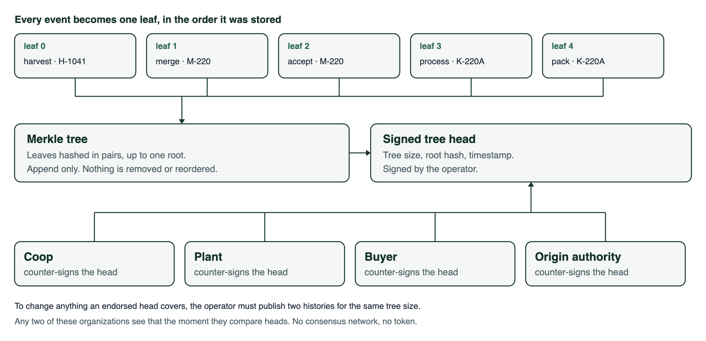
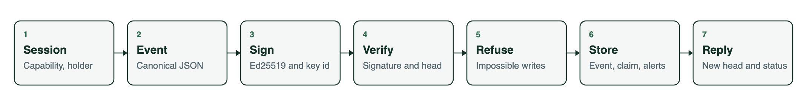
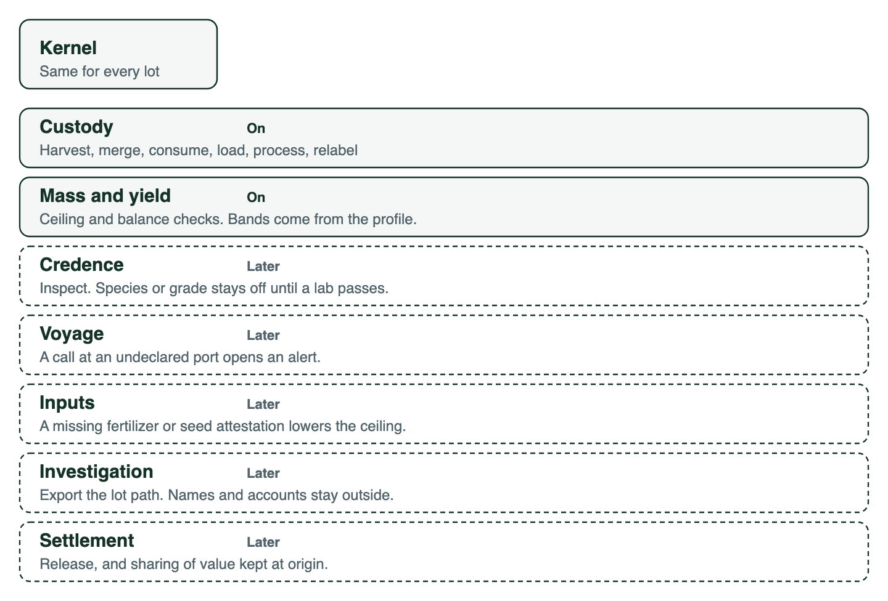

# Solution blueprint, technical architecture, and MVP roadmap

This is the build document for the first version of agriChain. Product rules stay in [system.md](system.md) and [design-laws.md](design-laws.md). This document says how the first corridor is built, on what, and in what order.

The MVP is one cashew corridor with a small set of organizations who accept a single operator’s database, provided every handoff is signed and hash-chained. A shared ledger is a later move, made when a second operator will not accept that database.

## Decisions locked for the MVP

| Decision | Choice |
| --- | --- |
| Who may disagree with the database | Coop, plant, buyer, and origin authority accept one operator. Each event is signed by the organization that witnessed it. Any of them can recompute the hash chain. |
| Who writes a harvest | A coop clerk, in a web app, naming the grower and the parcel. Growers are records. They do not need an account in the MVP. |
| What a stranger sees | A public claim page: commodity, biological origin country, process countries, claim status, packing expiry, and a quantity band. Exact weight, coordinates, and document hashes stay behind a role. |
| How a lot changes hands | A `transfer` signed by the custodian and an `accept` signed by the receiver. Custody moves on the `accept`. A `transfer` nobody accepts opens an alert. |
| Where private data lives | The same Postgres database. Narrow views are API projections and database privileges, not a second store. |
| What “ledger” means here | An append-only event log with a transparency log over it: signed tree heads, counter-signed by each organization, with inclusion and consistency proofs. No token, no public chain, no consensus network. The reasoning is in [ledger.md](ledger.md). |

Offline capture at the farm gate is not in the MVP. Add it only if the pilot coop cannot record the harvest at a connected buying point.

## Solution blueprint

agriChain keeps a lot of cashew honest from a parcel in Côte d'Ivoire to a European buyer. It answers three questions: what this is, where it grew, and which country kept the value of each step.

### People in the pilot

| Who | Account | What they write or read |
| --- | --- | --- |
| Grower | None | Named on a harvest. No login. |
| Coop clerk | Yes | Registers parcels, writes harvests, merges lots, transfers the lot to the plant, records the load that leaves the country. |
| Plant clerk | Yes | Accepts custody of a lot, records processing, loss, and outputs, packs and inspects. |
| Buyer | Yes | Reads the claim, the last inspection, and a quantity band, for lots transferred to it. |
| Origin authority | Yes | Reads volumes leaving Côte d'Ivoire and where processing happened. |
| Auditor | Yes, granted by the operator | Opens the full path when an alert exists. |
| Public | None | Opens a claim page from a code on the bag. |

A broker is an organization that can enroll and sign events it witnessed. The MVP does not need one on the first path. The data model still has a place for that organization, because the middle of the chain is where the record has to exist.

### Path of a lot

The coop clerk signs until the lot leaves the country, ending with a `transfer` to the plant. The plant clerk signs the `accept` that takes custody, then the processing. The claim is calculated. Biological origin stays the country of harvest. The plant’s country is added beside it.


The same lot is narrower for a stranger than it is for the coop.


### What the pilot has to prove

- A harvest names a parcel, a season, a grower, and a weight.
- Several harvests become one lot, and every input stays attached.
- Every change of hands has two signatures: the side letting go, and the side taking it.
- The plant cannot ship more kernel than the raw nuts support. Loss is declared. Shells are either an output or part of that loss.
- The public claim says the nuts grew in Côte d'Ivoire even when they were cracked somewhere else.
- An over-yield, a short mass balance, a relabel that moves the date, or a handoff nobody accepted opens an alert and still keeps the event.
- An alert on a harvest lot is still visible on the claim of the lot it was merged into.
- The origin authority can see whether the cracking happened at home or abroad.

Settlement, payments, and an investigation graph are not part of this proof.

## Domain model

Quantities are integers in grams. There are no floating-point weights.

### Records

The six records in [system.md](system.md) map to tables as follows.

| Record | Table | Notes |
| --- | --- | --- |
| Actor | `actors`, `memberships` | A person or an organization. A clerk belongs to one organization. |
| Place | `places` | Parcel, plant, port, or vessel. A parcel holds a season yield ceiling in grams. |
| Lot | `lots` | One commodity. `biological_origin_country` is insert-only. `holder_org_id` is the current custodian. `profile_version` records the configuration the lot was judged under. |
| Event | `events` | Append-only. The lot stores `head_event_id`. |
| Claim | `claims` | Rebuilt in the same transaction as the event that changed it. |
| Alert | `alerts` | Opened by a check. Never deletes the event. |

Growers and parcels can exist before any login. A parcel stores country, area, commodity, season, and a manual yield ceiling. For the MVP that ceiling is entered by the coop from a published figure for the area. It is the number the harvest is judged against.

`lots.holder_org_id` is a projection, not a second source of truth. It is written in the same transaction as the `accept` event that moved custody, and the write path reads it instead of replaying the chain on every request. An auditor can rebuild it from the events alone.

`lots.profile_version` is set when the lot is created and never changes. A band, a tolerance, or a claim field can be edited in configuration later, so without this a published claim would silently change meaning. The claim is always recomputed against the version the lot carries.

### Event types in the MVP

| Type | Who signs | What it does |
| --- | --- | --- |
| `harvest` | Coop | Creates a lot. Sets biological origin. Names parcel, grower, season, weight. Custody starts with the signer. |
| `merge` | Current custodian | Creates an output lot. Consumes each input lot. Output weight equals the sum of inputs. Commits to each input lot’s head hash. |
| `consume` | Written by the server, in the same transaction as `merge` or `process` | Closes an input lot and points at the output. Never submitted by a client, so it has no capability of its own. |
| `transfer` | Current custodian | Names the receiving organization and the reason. Custody does not move yet. |
| `accept` | Receiving organization | Takes custody. Moves `holder_org_id`. The only event that changes the custodian. |
| `load` | Custodian | Records carrier, origin port, destination port, and the country the lot is leaving. |
| `process` | Plant | Consumes the input lot. Creates output lots. Declares additives and loss. Records the process country. |
| `pack` | Plant | Sets the packing expiry and mints the public code the bag carries. Runs once per lot. |
| `inspect` | Lab or plant | Stores a pass or fail and the hash of the report. Does not store the file. |
| `relabel` | Custodian | Proposes a new label, code, or expiry. The claim keeps the packing expiry from `pack`. |

`split`, vessel `call`, and `release` exist as names in the product model. They are not required to finish the cashew MVP. A voyage with an extra port is the first event type added when a real shipment needs it.

`inspect` stays in the kernel rather than in a module. The buyer view and the Phase 5 exit check both depend on it, and a pass or fail with a report hash needs no commodity knowledge. What the Credence module adds later is claim *gating*, the rule that a species or a honey grade may not be published without a passing inspection. That gate is off for cashew.

In the pilot the plant signs `inspect`. No lab is enrolled on the first path, which is why the people table has no lab row. Granting `write:inspect` to a lab is a row, not a schema change.

### Canonical event

Every event is a JSON object serialized by RFC 8785, the JSON Canonicalization Scheme, and signed as UTF-8 bytes:

```json
{
  "id": "uuid",
  "lot_id": "uuid",
  "type": "harvest",
  "prev_hash": "hex or null for the first event",
  "actor_id": "uuid of the signing organization",
  "key_id": "uuid of the signing key version",
  "observed_at": "RFC 3339 instant the signer witnessed this",
  "payload": {}
}
```

RFC 8785 is named rather than described, because "a fixed field order" is not something a second party can reimplement. A coop, a buyer, and an auditor have to produce the same bytes from the same event or none of them can check a signature.

`event_hash` is SHA-256 of those canonical bytes. The organization signs `event_hash` with Ed25519, and the stored row keeps `event_hash`, `signature`, and `key_id` beside the event. The lot’s chain links `prev_hash` to the previous event’s `event_hash`. The first event on a lot uses `prev_hash: null`, and only one such event is allowed.

`observed_at` is signed by the clerk and is the time the thing happened. The server’s `received_at` is stored outside the signature and is the time the record arrived. The two are different facts, and expiry, season, and the transfer window all depend on the first one. The server rejects an `observed_at` in the future or older than a window the profile sets.

The server rejects a body whose signature does not match the public key of that `key_id`, whose `key_id` does not belong to the signing organization, whose `prev_hash` is not the current head, or whose `id` has already been stored. A retry of the same `id` returns the stored event.

A merged lot’s first event is `merge` with `prev_hash: null`, so the per-lot chains do not link across the merge on their own. The merge payload therefore commits to the `event_hash` of each input lot’s head. Lineage is then hash-committed in both directions: the `consume` on the input points forward, and the hash in the merge payload points back.

### Claims and bands

A claim is derived. Users do not edit it.

| Field | Rule |
| --- | --- |
| Commodity | Copied from the harvest. |
| Biological origin | Copied from the harvest. No later event writes this field. |
| Process countries | Appended by each `process` event, in order. |
| Status | `clear` or `alert`. An alert inherited from a consumed input lot also shows `alert`. |
| Packing expiry | Set by the `pack` event. A `relabel` does not replace it. |
| Quantity band | A bucket from the commodity profile, not the gram value. The cashew profile uses under 1 t, 1–5 t, 5–20 t, and 20 t and over. |

The buyer and the public page receive the band. The coop, the plant, and an opened audit receive grams.

### Rejected writes and opened alerts

Two different outcomes, and the docs used to confuse them. A write is rejected when what it claims is impossible, because there is nothing true to record. A write is stored with an alert when what it claims is merely implausible, because the record is the signal. The design law is "Implausible before criminal", not "implausible is refused".

Rejected. Nothing is stored.

| Check | Rule |
| --- | --- |
| Over-emission | Outputs plus declared loss exceed the input. More came out than went in, which is not a thing that happened. |
| Origin write | Any attempt to update `biological_origin_country` fails the transaction. |
| Wrong custodian | The signing organization is not the current holder. |
| Double pack | A second `pack` on a lot that already has a packing expiry. |

Stored, and the claim status becomes `alert`.

| Check | Rule |
| --- | --- |
| Yield ceiling | Sum of harvests for that parcel and season is greater than the ceiling. |
| Merge shortfall | Output grams fall short of the sum of input grams by more than the profile tolerance. |
| Process shortfall | Outputs plus declared loss fall short of the input by more than the profile tolerance. Additives are inputs. |
| Unaccepted transfer | A `transfer` with no matching `accept` after the window the profile sets. |
| Relabel | The new expiry is later than the packing expiry, or the public code changes. |
| Inherited alert | An input lot had an open alert when it was consumed. |

The tolerance is a profile value in grams or basis points, not a constant in the handler. Cashew drying loses weight between the farm gate and the intake scale, and a corridor that weighs wet nuts needs a different number than one that weighs dry.

### Alerts survive a merge

An alert is opened on a lot. A merge consumes that lot and creates a new one, so without a rule the status does not follow the goods: a clean output lot would carry no sign of an over-ceiling harvest, and because an audit may only be opened on an alerted lot, the trail would close at the same moment. Laundering a bad harvest would be one merge.

- The output of a `merge` or a `process` inherits an open alert from any input lot, stored as its own alert row referencing the source lot and the source alert.
- An audit may be opened on a lot that has an alert of its own, or that is an ancestor or a descendant of an alerted lot. The lineage is walked through `consume` events.
- Closing the source alert does not rewrite the inherited row. It records the resolution beside it.

## Technical architecture

One web service and one Postgres database. The browser signs. The API checks and stores. Views are queries.


There is no worker, cache, or object store in the MVP. Document files stay with the party who holds them. The event stores the SHA-256 of the file.

### Stack

| Layer | Choice |
| --- | --- |
| Language | TypeScript |
| Service | Next.js (App Router). The UI and the HTTP API ship as one service. |
| API | Versioned route handlers under `/api/v1`. The UI is a client of that API. |
| Database | Postgres 16 |
| Schema and queries | SQL migrations. Drizzle for queries. |
| Validation | Zod, one schema per event type |
| Auth | Auth.js session cookies for staff. Organization and role live in `memberships`, not in the auth provider. |
| Signatures | Ed25519 in the browser via WebCrypto. Server stores public keys only, one row per key version. |
| Canonical form | RFC 8785 (JSON Canonicalization Scheme) |
| Hash | SHA-256 over the canonical bytes |
| Transparency log | Merkle tree and proofs after RFC 6962. Computed in the service, stored in Postgres. |
| Hosting | One region, one service, managed Postgres, daily backups |

The private key is generated in the browser when an organization enrolls. It is encrypted with a passphrase the organization keeps. The server may store the ciphertext so a new clerk machine can download it. The server cannot decrypt it. Signing happens in the browser after the passphrase is entered.

### Key versions

One key per organization with no version is a trap. Clerks share the passphrase, so a clerk who leaves still holds it, and the only remedy is a new key. If events do not say which key signed them, replacing the key makes every past signature unverifiable, and the custody property this MVP owes is gone.

- `org_keys` holds one row per key version: organization, public key, `created_at`, `revoked_at`, and the reason.
- Every event stores `key_id`. Verification uses the key named by the event, not the organization’s current key.
- A revoked key still verifies events it signed before `revoked_at`. It cannot sign new ones.
- Rotation is enrollment again: the browser generates the next version, the operator records it, and the old row gets a `revoked_at`.
- An event whose `observed_at` falls after its key’s `revoked_at` is rejected.

Nothing here needs a new event type. Rotation is rows in `org_keys`, which is why it belongs in the MVP even though no pilot organization will rotate during it.

### Transparency log

Signatures and per-lot hash chains show that history was not rewritten. They do not show that the operator is not the only party who decides what history is. One operator's database is controlled by one firm, and the episode asks for a record that no single firm controls. This section is the part that answers that. The decision, and what was rejected, is in [ledger.md](ledger.md).



- `log_leaves` holds one row per event in insertion order: `seq`, `event_id`, and `leaf_hash`, which is the event's `event_hash`. The leaf is appended in the same transaction that inserts the event.
- `tree_heads` holds a signed tree head: `tree_size`, `root_hash`, `signed_at`, and the operator's signature over those fields.
- `head_endorsements` holds one row per organization per head: `tree_size`, `org_id`, `signature`, `signed_at`.
- An **inclusion proof** shows that an event is a leaf of the tree of a given size. An organization checks it for its own events.
- A **consistency proof** shows that the tree of size `n1` is a prefix of the tree of size `n2`. This is what catches a removal, an alteration, or a reorder.

Once a party holds a head it counter-signed, the operator cannot change anything the head covers: the consistency proof fails, and four other organizations hold a head that disagrees. Cheating requires publishing two histories for the same tree size, which any two parties see the moment they compare heads.

The log publishes hashes and a count. It publishes no payload, so a leaf says nothing about a grower, a weight, or a parcel, and "Translucent, not glass" is unaffected. The tree size does reveal how many events exist. That is accepted.

### Write path



1. The clerk’s session is a member of the organization, the organization holds the capability for that event type, and it is the lot’s current holder.
2. The browser builds the canonical event using the lot’s current `head` hash, its own `key_id`, and `observed_at`.
3. The browser signs `event_hash` and posts the event.
4. The API checks the session, the capability, the holder, the signature against that `key_id`, the payload schema, and the head.
5. The API runs the rejecting checks. A failure here returns an error and stores nothing.
6. One database transaction inserts the event, appends its leaf to the transparency log, moves the head, writes any `consume` events, moves `holder_org_id` on an `accept`, rebuilds the claim against the lot’s `profile_version`, and inserts alerts, including any inherited from a consumed input.
7. The response is the new head and the claim status.

Two clerks racing on the same lot: the second insert fails the unique constraint on `(lot_id, prev_hash)`. The client reloads the head and asks the clerk to submit again.

### Read path

| Route | Caller | Returns |
| --- | --- | --- |
| `GET /api/v1/claims/:code` | Public | Claim projection and quantity band. |
| `GET /api/v1/lots/:id` | Holder organization | Lots they signed or currently hold, with gram weights. |
| `GET /api/v1/lots/:id/claim` | Buyer the lot was transferred to | The claim, the band, and the last inspection with its report hash. |
| `GET /api/v1/transfers/incoming` | Receiving organization | Transfers awaiting an `accept`. |
| `GET /api/v1/authority/retention?country=&season=` | Origin authority for that country | Weight leaving, and the share of process events in that country. Aggregates only, never a lot row. |
| `GET /api/v1/lots/:id/audit` | Auditor, when the lot has an open alert or is in the lineage of an alerted lot | Full events, facility ids, gram weights, document hashes. |
| `GET /api/v1/log/head` | Any enrolled organization | The latest signed tree head and the endorsements on it. |
| `GET /api/v1/log/inclusion?event_id=&tree_size=` | The organization that signed the event, or an auditor | An inclusion proof for that event. |
| `GET /api/v1/log/consistency?from=&to=` | Any enrolled organization | A consistency proof between two tree sizes. |

The audit read is written to an `audit_opens` row: who, when, and which lot.

### Database rules

- The application role may `INSERT` into `events` and may not `UPDATE` or `DELETE` them.
- A trigger rejects updates to `lots.biological_origin_country`.
- `events.id` is unique.
- `(lot_id, prev_hash)` is unique, which serializes two clerks racing on the same head.
- A partial unique index on `lot_id` where `prev_hash is null` allows exactly one first event per lot. A plain composite unique does not do this, because Postgres treats each null as distinct and would let a lot have many first events.
- A trigger rejects updates to `lots.profile_version`.
- `claims` is updated only by the transaction that inserted the event.
- The application role may `INSERT` into `log_leaves` and may not `UPDATE` or `DELETE` them. `seq` is monotonic and `event_id` is unique, so a leaf cannot be added twice or inserted out of order.
- `tree_heads` and `head_endorsements` are insert-only. A head is never amended; a later head supersedes it.

### Authorization

| Role | Harvest and merge | Process and pack | Transfer and accept | Read grams | Read claim | Open audit |
| --- | --- | --- | --- | --- | --- | --- |
| Coop clerk | Own lots | No | Both, on lots it holds | Own lots | Yes | No |
| Plant clerk | No | Lots the plant holds | Both, on lots it holds | Those lots | Yes | No |
| Buyer | No | No | Accept only | No | Lots transferred to it, plus last inspection | No |
| Origin authority | No | No | No | Country aggregates only | No | No |
| Auditor | No | No | No | Lots in an alerted lineage | Yes | Yes |

A clerk can sign only with a key of their own organization, and only for a lot that organization currently holds. Two events are exceptions: `harvest` creates the lot, and `accept` is by definition signed by an organization that does not hold the lot yet.

The origin authority reads aggregates and nothing else. It has no claim column above, because a claim is about one lot and this reader is never given one.

That table is the cashew seed, not the authorization model. A profile grants capabilities to an organization kind, and the API asks whether the organization holds the capability:

`write:harvest`, `write:merge`, `write:transfer`, `write:accept`, `write:load`, `write:process`, `write:pack`, `write:inspect`, `write:relabel`, `read:grams`, `read:claim`, `read:aggregates`, `open:audit`.

`consume` has no capability. It is written by the server inside the merge and process transactions and is never accepted from a client. A lab or a port agent is a new grant, not a new column.

## Kernel and configuration

Lots, events, and claims stay generic. Cashew settings live in seed data: profile, corridor, bands, merge policy, claim fields, enabled checks, and capability grants. The harvest handler does not contain a commodity name or an origin country. A later concern adds a module and rows, as set out in [qa-modularity.md](qa-modularity.md).



## MVP roadmap

Phases are sequential. A phase is done when its exit checks pass, not when the screens exist. Dates wait until a pilot coop and a plant are named.

### Phase 1 — Parcel and harvest

Enroll a coop organization, register a parcel with a ceiling, and record a harvest signed in the browser.

Exit checks:

- A harvest from an unknown key is rejected.
- A second harvest that pushes the parcel over its ceiling is stored, and the lot’s claim is `alert`.
- `biological_origin_country` cannot be updated.
- The grower has no user account.
- The harvest path reads the cashew profile from configuration. It does not hard-code the commodity or the origin country.
- The harvest handler does not contain the strings `cashew` or `Côte d'Ivoire`.
- An enrolling organization cannot set its own kind. The kind is recorded by the operator, and an organization awaiting approval can sign nothing. Self-declaring as an origin authority or an auditor would otherwise be a read-privilege escalation.
- Two events signed by two key versions of the same organization both verify.
- Every stored event has exactly one leaf in `log_leaves`, appended in the same transaction. A rolled-back write leaves no leaf behind.

### Phase 2 — Named merges

A clerk merges several harvest lots into one intake lot.

Exit checks:

- Every input lot has a `consume` event pointing at the output.
- A consumed lot cannot be merged again.
- Output grams above the sum of inputs is rejected. A shortfall beyond the profile tolerance is stored with an alert.
- The merge payload holds the head hash of every input lot, and an auditor can verify the lineage from the hashes alone.
- The output lot’s biological origin is copied from the inputs.
- An over-ceiling harvest lot merged into a clean lot leaves the output claim at `alert`, naming the source lot.
- The cashew profile rejects a mixed-origin merge. The test fixture uses Côte d'Ivoire. The merge code does not.

### Phase 3 — Handoff, load, and process

Move custody to the plant with two signatures, record the lot leaving the country, and record the plant turning raw nuts into outputs plus a declared loss.

Exit checks:

- A `transfer` does not move custody. The coop is still the holder until the plant signs the `accept`.
- Only the named receiving organization can accept. Another organization’s accept is rejected.
- A `transfer` left unaccepted past the profile window opens an alert, and the lot is still held by the sender.
- The process country is stored beside biological origin. The pilot plant is abroad. A profile may process at home.
- Outputs plus loss above the input is rejected. A shortfall beyond the profile tolerance is stored with an alert.
- The plant cannot process a lot it does not hold, and could not hold it without an `accept`.

### Phase 4 — Pack and claim

Set the packing expiry, mint the public code, and publish the derived claim.

Exit checks:

- `pack` sets the packing expiry and the public code. A second `pack` on the same lot is rejected.
- The public route returns commodity, origin, process countries, status, packing expiry, and a quantity band.
- The public route does not return grams, parcel coordinates, grower name, or document hashes.
- A relabel with a later expiry leaves the packing expiry on the claim and opens an alert.
- Editing a band in configuration does not change the claim of a lot already packed, because the claim is rebuilt against the lot’s `profile_version`.

### Phase 5 — Authority and audit

This is the end of the MVP.

Exit checks:

- The origin-authority page shows weight leaving Côte d'Ivoire and the share of process events that happened there, as aggregates. No lot row and no single-lot weight appears on it.
- An auditor can open a lot only when it has an alert or sits in the lineage of an alerted lot, and the open is logged.
- An auditor can walk from an alerted harvest lot to the packed lot it ended up in.
- A buyer sees the claim, the last inspection result with its report hash, and the band, and only for lots transferred to that buyer.

### Phase 6 — Proofs

The transparency log becomes checkable. Leaves have been written since Phase 1; this phase publishes heads and serves proofs.

Exit checks:

- The operator signs a tree head, and each enrolled organization can fetch it and counter-sign it.
- An organization gets an inclusion proof for an event it signed and verifies it against a head it counter-signed, without asking the operator to vouch for anything.
- A consistency proof between two tree sizes verifies.
- An event altered directly in the database fails its inclusion proof against an endorsed head. This test is run by editing a row with database access the application role does not have.
- A leaf removed or reordered fails the consistency proof.
- Verification uses only the head, the proof, and the event. It does not re-query the operator for the answer.

### After the MVP

In this order, and only when the pilot asks for them:

1. Fertilizer or seed attestation that lowers a parcel ceiling when the attestation is missing.
2. Vessel calls, so an undeclared port opens an alert.
3. An export bundle for an external investigation graph: lot path, hashes, and organization ids. No KYC dossier in this database.
4. Honey as a second commodity, where the fraud is content and a price premium.
5. Fish only with a lab attestation required before a species claim.
6. Settlement and retained-value sharing.
7. An offline client, if buying points have no signal.
8. A public-chain anchor for the tree head, as a third-party timestamp. One hash, no payload, no token held. Deferred because it puts a funded wallet into the operations of a pilot, and a counter-signed head settles most disputes without it.
9. A permissioned ledger for the hash chain, if a second operator refuses this database. The event JSON and the leaf definition stay the same so the log can move.

## Out of scope

- A token, a coin, or tokenized inventory.
- Full KYC, crew identities, and beneficial-ownership graphs.
- Public prices and public parcel coordinates.
- A grantor or donor portal.
- A model that writes events or invents an origin.
- Storing scans of shipping documents. Hashes only.
- Multi-region deployment and a mobile app.

## How this stays honest

The operator can refuse to publish, and can go offline. The operator cannot rewrite a history that other parties have already verified, because those parties hold the signatures, the hashes, and a tree head they counter-signed. Changing anything an endorsed head covers breaks a consistency proof, and the only way around that is to publish two histories for the same tree size, which any two organizations see when they compare heads. That is what makes this a record no single firm controls, rather than a database with good intentions.

It is not a claim that a cartel is inside the database. When an alert fires, the trail leaves this system and goes to people who investigate companies and accounts.
