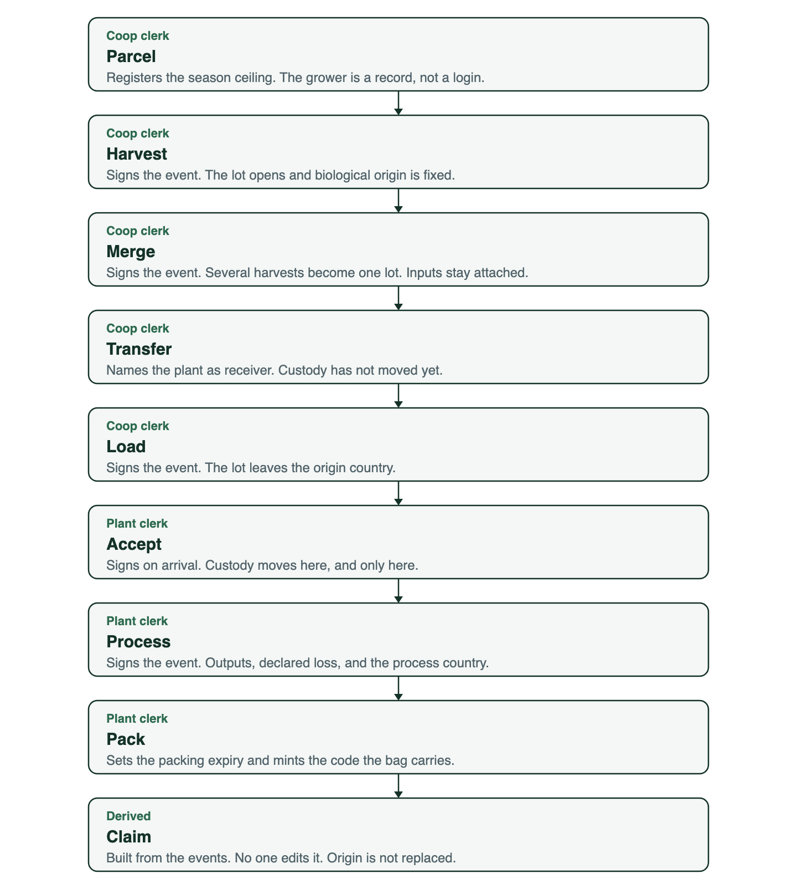

# Brief

Food fraud, in this telling, is organized crime inside the value chain. It is easier to move than people or arms because nobody is looking. The harm is sickness and death, stolen origin, and value that never reaches the people who grew the crop.

## Figures stated on the episode

| Figure | What she said |
| --- | --- |
| 20% | Share of seafood she calls fraudulent |
| $65 billion | Yearly cost of fighting food fraud, cited via Interpol |
| 57 | Average age of a farmer, globally |
| 92% | Share of Ivorian cashews not processed in Côte d'Ivoire |

The horsemeat aside quotes both $30 million and $300 million. Treat that dollar amount as unresolved. Cashew farmgate prices in the auto-transcript are garbled and are not used.

## Three failures

**Content.** The thing in the bag is not the thing on the label. Blowfish sold as a delicacy fish. Horsemeat sold as beef. Milk that is not milk. Honey cut with sucrose and still badged as honey.

**Source.** Legal origin is awarded to whoever processes. Dutch food, Swiss chocolate, nuts bagged in the US or Europe. A QR code and a due date can be swapped after the goods are stale.

**Value.** She uses “value chain” rather than “supply chain”: can the grower country raise the value before the good leaves? If not, cartels fill the gap and farmers age out of the work.

## What the technology is for

A distributed ledger is chain of custody: the same discipline applied to evidence, applied to goods. It keeps data that no single firm or country controls, and it shows the data was not rewritten. It is not a coin. Projects that tokenized bananas without paying the people in the middle failed the only test that matters: why would each hand write the next record?

The ledger cannot hold the crime. Over-the-counter commodity trades, fake shipping documents, and shell-company directors do not live on the chain. A ledger can show that a lot left a factory and met a ship. An investigation system has to join that to people, accounts, and companies when something smells wrong. Her image for the join is a lab tunnel: known input, unexpected output, so the crime is whatever happened in between.

## How a lot moves

The coop clerk signs the lot until it leaves the country. Every change of hands takes two signatures: the side letting go, and the side taking it. The plant clerk signs the processing. The claim is derived from those events.

Who can see that lot, and how little the public page shows, is drawn in the [blueprint](blueprint.md#path-of-a-lot).
