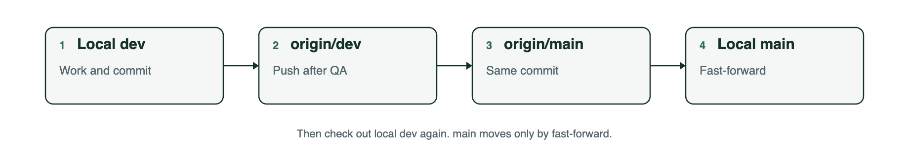

# Git plan

Work happens on local `dev`. `main` receives a commit only after that commit has passed QA and is already on `origin/dev`.

Remote: [kayzredman/agrichain](https://github.com/kayzredman/agrichain.git).

## Day to day

Stay on local `dev`. Commit there. Do not commit on `main`.

## After QA

Promote the QA'd commit in this order.

1. Push local `dev` to `origin/dev`.
2. Push that same commit to `origin/main`.
3. Fast-forward local `main` to match `origin/main`.
4. Check out `dev` again before the next change.



```bash
git push origin dev
git push origin dev:main
git checkout main
git merge --ff-only origin/main
git checkout dev
```

`main` moves only by fast-forward. If the push to `origin/main` is rejected, stop. Do not force-push.

## What each branch means

| Branch | Where | What it holds |
| --- | --- | --- |
| `dev` | Local, then `origin/dev` | The working line. QA runs against this. |
| `main` | `origin/main`, then local | The last commit that passed QA and was pushed to `origin/dev`. |

Local `main` is updated last, so it never sits ahead of the remote.
