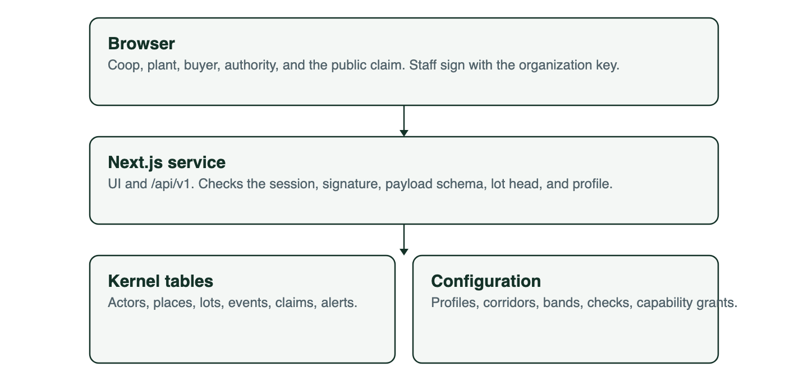
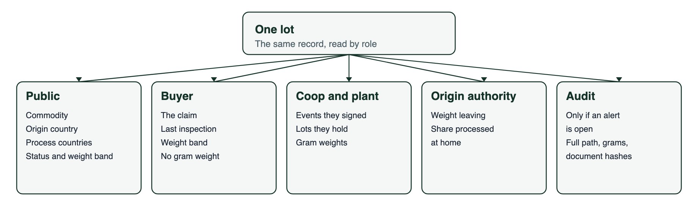

# agriChain

A shared custody record for agricultural lots, plus a plausibility check, plus a narrow door to investigators. It answers three questions kept separate on the episode: what is this, where did it grow, and who kept the value.

Stack, signing, and the phase plan for the first build are in [blueprint.md](blueprint.md).

agriChain keeps the lot honest. A system like Siren, which hosts the source episode, is the place to join an opened alert to companies, accounts, and people. Those two jobs are not the same database.

## Six records

| Record | Holds |
| --- | --- |
| Actor | A grower, coop, aggregator, plant, broker, carrier, lab, buyer, or authority. Credentialed. Not a dossier. |
| Place | A parcel with a season yield ceiling, a plant, a port, or a vessel. |
| Lot | A quantity of one commodity. Biological origin set once. Grade and expiry set when they become true. |
| Event | A witnessed change: harvest, merge, split, transfer, accept, process, pack, load, call, inspect, relabel, release. |
| Claim | What a label is allowed to say, derived from events. Origin, species, halal, honey, date. |
| Alert | A short mass balance, a broken ceiling, a handoff nobody accepted, a route gap, a relabel, or a destination-grade shock. |

## Who may see what

| Right | Sees |
| --- | --- |
| Public claim | Commodity, biological origin country, process countries, claim status, packing expiry, quantity band. |
| Current holder | Events they signed and the lots they hold now. A lot is held until the next party signs an accept. |
| Origin authority | Volumes leaving, and which process steps happened at home. Aggregates, never a lot. |
| Buyer | The claim, last inspection, and a quantity band, for lots transferred to that buyer. Not the grower's coordinates. |
| Opened audit | Full path, facility ids, exact quantities, document hashes. Openable on an alerted lot and on the lots it came from or became. |

## Invariants

Two outcomes, kept apart. A write is refused when it claims something impossible. A write is stored with an alert when it claims something merely implausible, because there the record is the signal.

Refused. A process event cannot emit more than it received, after a declared loss; additives are inputs. Biological origin has no update operation. A lot cannot be signed by an organization that is not its current holder. Custody moves only on an accept, so a handoff always has two signatures.

Stored, with an alert. A parcel that certifies more harvest in a season than its ceiling. A process or merge that falls short of its inputs by more than the corridor's tolerance. A relabel that moves expiry later in the story than packing, which is how stale goods get a second life. A transfer that no one accepts. An alert on a lot follows the goods into the lot it is merged into, or a merge would wash it off.

Two invariants belong to modules that are off for the cashew pilot, and are listed here as product rules rather than MVP behaviour: the ceiling drops when fertilizer or seed attestations are missing (Inputs), and a ship event that skips a declared port, or adds one, opens an alert rather than rewriting the route (Voyage).

## Kernel and configuration

The records, the signed event envelope, and the write path are the kernel. They do not name a commodity or a country.

A commodity profile and a corridor are configuration in Postgres. The profile lists enabled event types, enabled checks, claim fields, quantity bands, merge policy, and which capabilities each organization kind has. The corridor names the profile and the origin country. The cashew pilot is the first seed, not a rule in the harvest flow.

A later concern (honey, fish, fertilizer, a vessel call, an investigation export) is a module plus rows in that configuration. The module may add an event type, a named check, a claim field, or a read projection. It does not add another lot table. The QA of this split is in [qa-modularity.md](qa-modularity.md).

## First corridor

Cashew, Côte d'Ivoire to a processor country to a European buyer. It forces aggregation of many small growers, a process step that today steals the origin story, and a value-retention number a government can read. Those facts are seed data for the `cashew` profile and one corridor.

Honey is the second corridor, because the fraud there is content and a price premium. Fish needs a lab attestation on the inspect event before species claims are allowed.

## Build order

The five MVP phases, matching the exit checks in [blueprint.md](blueprint.md).

1. Parcel and harvest.
2. Named merges.
3. Handoff, load, and process mass balance.
4. Packing, and a claim that cannot confuse biological origin with processing country.
5. Authority aggregates and opened audit.

Alerts are not a phase. Phase 1 already raises one, because a yield ceiling with no alert is a number nobody acts on.

Then, and only when the pilot asks: an export bundle for an investigation graph, and later settlement and retained-value sharing, once actors are writing true events. A token issued before that order is the banana project already dismissed on the episode.

## Leave these out

- Full KYC and crew identities on the chain.
- Public prices and parcel coordinates.
- A single-buyer private ledger.
- A grantor portal as the reason to participate.
- An AI label that overrules a missing custody event.
- A design that treats the broker as a user to be watched, rather than a writer who needs a reason to sign.
